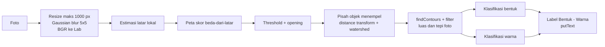

# Klasifikasi Bentuk dan Warna (Tema 8)

UTS Praktikum Visi Komputer - Kelompok 8

## Anggota Tim

| Nama | NPM |
|---|---|
| Suci Wiranda | 2408107010077 |
| Aqila Ruqayyah | 2408107010070 |
| Syifa Salsabila | 2408107010018 |
| Shara Sitta Safiruddin | 2408107010067 |

## Deskripsi

Program menerima foto potongan kertas berbagai bentuk dan warna, lalu memberi label pada setiap benda dalam format `Bentuk - Warna`, misalnya `Segitiga - Merah`.

- **Bentuk (6):** segitiga, persegi, persegi panjang, lingkaran, bintang, love
- **Warna (9):** merah, kuning, hijau, biru, hitam, mint, ungu, pink, soft pink
- **Library:** hanya OpenCV, NumPy, dan Matplotlib (plus modul standar Python seperti `csv` dan `pathlib`). Tanpa deep learning.

Seluruh pekerjaan ada di satu notebook, `UTS_Kelompok08.ipynb`: pipeline, evaluasi seluruh dataset, eksperimen pembanding, analisis kegagalan, dan uji pada foto baru.

## Pipeline



| Tahap | Metode | Alasan |
|---|---|---|
| Praproses | Resize, GaussianBlur 5x5, BGR ke Lab | Menghaluskan noise kamera. Jarak warna di Lab mendekati persepsi manusia dan memisahkan kecerahan (L) dari warna (a, b). |
| Estimasi latar | Median blur pada citra 1/8, lalu rata-rata Gaussian berulang (4 iterasi) | Latar tidak rata (gradasi cahaya, lantai, bayangan). Objek dikeluarkan dulu agar tidak mengotori estimasi latar. |
| Peta skor | Kroma (a, b) terhadap latar, atau "gelap sekali" | Kertas berbeda **warna** dari latar, sedangkan bayangan hanya beda **kecerahan**, sehingga bayangan tidak ikut terdeteksi. |
| Threshold | `cv2.threshold` pada skor (ambang 8) | Kertas pastel (soft pink, mint) tetap lolos. |
| Morfologi | Opening 7x7 lalu 5x5 | Membuang garis tipis (nat lantai, tepi meja) tanpa merusak objek. |
| Pisah objek menempel | Distance transform + watershed | Potongan yang bersentuhan menjadi satu komponen; marker dari inti distance transform memisahkannya. |
| Kontur | `findContours` (RETR_EXTERNAL) + filter luas/tepi | Membuang noise, bayangan besar, tangan, dan tepi foto. |
| Bentuk | `approxPolyDP`, `arcLength`, `convexHull`, solidity, convexity defects, kecocokan elips, rasio sisi | Aturan berbasis jumlah titik sudut dan ciri kecekungan (lihat di bawah). |
| Warna | Sudut dan kekuatan warna (a, b) objek relatif terhadap latar | Tidak bergantung pada warna lampu dan bayangan. |

**Aturan bentuk:**

1. Banyak cekungan dalam (convexity defects >= 3) dan solidity < 0,80: **Bintang**
2. Cembung penuh dan menyerupai lingkaran/elips: **Lingkaran** (elips karena foto miring)
3. 3 titik pada epsilon 0,04: **Segitiga**
4. 4 titik: **Persegi** (rasio sisi < 1,4) atau **Persegi panjang**
5. Cembung tetapi bergelombang (>= 6 titik) dengan satu lekukan: **Love**

**Mode objek besar.** Untuk benda yang memenuhi sebagian besar foto (misalnya sticky note), estimasi latar tidak cocok. Mode ini memakai region growing: seed adalah bagian paling jenuh, wilayah adalah piksel yang warnanya (Lab) dekat dengan seed, dan warna ditentukan dengan `inRange` HSV. Fungsi `analisis_otomatis()` mencoba mode ini lebih dulu; jika tidak ada wilayah yang luasnya > 20% foto dan padat (solidity > 0,9), dipakai pipeline normal. Pemilihan otomatis ini bersifat heuristik dan dipakai pada bagian "Uji pada foto baru".

## Dataset

Foto potongan kertas yang dipotret sendiri oleh kelompok, disertai file `ground_truth.csv` (kolom `file`, `kondisi`, `jumlah_objek`, `keterangan`). Ground truth berisi daftar objek (bentuk + warna) tanpa posisi, sehingga pencocokan dilakukan sebagai multiset.

Evaluasi memakai **27 foto** dalam 4 kondisi:

| Kondisi | Jumlah foto | Keterangan |
|---|---|---|
| ideal | 10 | Dari atas, latar polos, cahaya baik |
| cahaya | 4 | Cahaya redup/kuning, pantulan lampu |
| sudut | 6 | Foto miring, latar ramai (keyboard, dll.) |
| sulit | 7 | Objek bersentuhan, terpotong tepi foto, bayangan |

## Hasil

Metrik:

- **Akurasi jumlah:** foto dengan jumlah objek prediksi = jumlah di ground truth.
- **Akurasi label:** pasangan (bentuk, warna) yang cocok dibagi max(jumlah GT, jumlah prediksi). Objek terlewat dan objek palsu sama-sama menurunkan nilai.
- **Akurasi bentuk / warna:** sama, tetapi hanya memeriksa bentuk atau warna saja.

| Kondisi | Foto | Jumlah tepat | Label | Bentuk | Warna |
|---|---:|---:|---:|---:|---:|
| ideal | 10 | 10/10 | 98,8% | 98,8% | 100,0% |
| cahaya | 4 | 3/4 | 86,7% | 93,3% | 90,0% |
| sudut | 6 | 4/6 | 84,4% | 84,4% | 93,3% |
| sulit | 7 | 2/7 | 78,6% | 82,1% | 85,7% |
| **Total** | **27** | **19/27** | **88,8%** | **90,7%** | **93,5%** |

Penyebab kegagalan utama:

- Objek yang saling menempel (watershed tidak memisahkan sambungan yang lebar).
- Cahaya redup: warna merah tua hampir hitam, dan pantulan lampu lolos sebagai objek palsu.
- Foto sangat miring: persegi menjadi jajar genjang sehingga terbaca persegi panjang.
- Objek terpotong tepi foto dan berada di bayangan.
- Ambiguitas lipatan origami "love" yang mirip bintang.

## Beberapa Gambar Hasil (sisanya di folder output)


## Eksperimen Pembanding

**A. Pengaruh epsilon `approxPolyDP`** (epsilon = e x keliling)

| Epsilon | Akurasi bentuk |
|---:|---:|
| 0,01 | 82,2% |
| 0,02 | 90,7% |
| 0,04 | 86,4% |
| 0,06 | 56,5% |
| 0,08 | 56,5% |
| default (0,02 + 0,04 untuk segitiga) | 90,7% |

Epsilon kecil terlalu teliti (persegi dan segitiga terbaca *love*); epsilon besar terlalu kasar (lingkaran tersisa 4-5 titik dan terbaca persegi). Karena itu dipakai dua epsilon.

**B. `HoughCircles` vs pipeline kontur untuk lingkaran** (jumlah lingkaran per foto)

| Metode | Foto tepat | MAE |
|---|---:|---:|
| Pipeline kontur | 26/27 | 0,04 |
| `HoughCircles` | 14/27 | 1,56 |

Hough terganggu nat lantai, pola keyboard, dan lipatan kertas, serta tidak cocok dengan lingkaran yang difoto miring (menjadi elips). Kekurangan kontur: bergantung penuh pada kualitas mask.

**C. Mask `inRange` HSV vs mask selisih-latar** (jumlah objek)

| Metode | Foto tepat | MAE |
|---|---:|---:|
| `inRange` HSV (baseline) | 3/27 | 2,48 |
| Selisih-latar (Lab) | 19/27 | 0,41 |

Catatan: baseline adalah cara awal tanpa estimasi latar, pemisahan objek menempel, dan filter tepi, sehingga sebagian selisih berasal dari tahap tambahan tersebut.

**D. Klasifikasi warna: `inRange` HSV vs Lab relatif latar** (objek yang sama)

| Kondisi | HSV `inRange` | Lab relatif latar |
|---|---:|---:|
| ideal | 100,0% | 100,0% |
| cahaya | 70,0% | 90,0% |
| sudut | 88,9% | 93,3% |
| sulit | 83,9% | 85,7% |
| **Total** | **89,3%** | **93,5%** |

Rentang HSV disusun setelah melihat dataset ini, jadi nilainya cenderung optimistis untuk data baru.

## Cara Install di Laptop Lokal

Prasyarat: Python 3.9 atau lebih baru dan Git.

```bash
# 1. Clone repositori
git clone https://github.com/<username>/<nama-repo>.git
cd <nama-repo>

# 2. (Disarankan) buat virtual environment
python -m venv venv
# Windows:
venv\Scripts\activate
# macOS / Linux:
source venv/bin/activate

# 3. Install dependensi
pip install -r requirements.txt

# 4. Jalankan notebook
jupyter notebook UTS_Kelompok08.ipynb
```

Letakkan folder dataset (foto `.jpg`) dan `ground_truth.csv` di samping notebook. Notebook mencari keduanya secara otomatis dari folder tempat notebook berada, dan membuat folder `output/` untuk menyimpan citra hasil. Jalankan sel dari atas ke bawah (*Run All*).

Untuk mencoba foto baru, ubah `FOTO_BARU` pada sel terakhir ke nama file foto.
